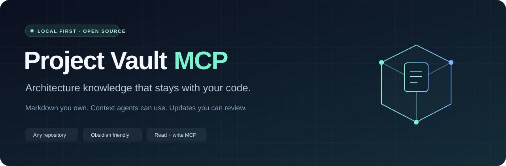
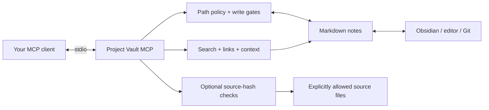

<div align="center">



[](https://github.com/OzgurH/project-vault-mcp/actions/workflows/ci.yml)
[](LICENSE)
[](https://nodejs.org/)
[](https://www.typescriptlang.org/)
[](https://modelcontextprotocol.io/)
[](https://obsidian.md/)
[](https://github.com/OzgurH/project-vault-mcp/actions/workflows/security.yml)
[](docs/security-controls.md)

**Give your agents a project memory you can read, edit, and keep in Git.**

[Quick start](#quick-start) · [Connect your agent](#connect-your-agent) · [Tools](#mcp-tools) · [Safe updates](#creating-and-updating-notes) · [Security](docs/security-controls.md) · [Privacy](docs/privacy.md) · [Contributing](CONTRIBUTING.md)

</div>

---

Project Vault MCP turns ordinary Markdown into a connected knowledge layer for a software project. It helps AI agents find architectural context, follow decisions, check references, and create or update notes through the Model Context Protocol.

Your notes stay on your filesystem. Use Obsidian, VS Code, another editor, or plain Git. There is no proprietary vault format, hosted knowledge service, embedding bill, or application-framework dependency.

## Why Project Vault?

A README explains how to start. Your architecture notes explain **why the project works this way**. Project Vault makes that second layer usable in day-to-day agent work.

| Capability | What you get |
| --- | --- |
| **Find the right context** | Ranked, heading-aware search with file IDs, line numbers, and revision metadata. |
| **Follow the architecture** | Markdown links, Obsidian wikilinks, backlinks, and explicit ambiguous-link diagnostics. |
| **Capture the reasoning** | Starter notes for architecture, modules, ADRs, and runbooks. |
| **Maintain notes through MCP** | Create and update tools with previews, explicit write gates, and revision checks. |
| **Notice drift** | Optional source-file hashes flag changed evidence. A matching hash is not proof that an architectural claim is correct. |
| **Bring your own project** | Adopt an existing notes directory or initialize a small knowledge layer. |

> **Local-first, with a clear boundary:** this server makes no model calls and sends no telemetry. Your MCP client can still send retrieved notes to its model provider. Only connect a project you intend that client to access.

## Quick start

Requires **Node.js 22.12 or later** and Git. This initial release is distributed through GitHub; there is no claim of an npm registry release.

```sh
git clone https://github.com/OzgurH/project-vault-mcp.git
cd project-vault-mcp
npm ci
npm run build
```

Preview a knowledge layer in a project directory:

```sh
node dist/src/cli.js init --root ../my-project
```

Create the missing starter files when the preview looks right:

```sh
node dist/src/cli.js init --root ../my-project --apply
node dist/src/cli.js check --root ../my-project
```

The initializer preserves existing files. If a configuration already exists, it leaves that configured project alone.

```text
my-project/
├── project-vault.json
└── docs/
    ├── index.md
    ├── architecture/overview.md
    ├── modules/index.md
    ├── decisions/index.md
    └── runbooks/index.md
```

Already have notes? Add a configuration pointing at them; no conversion is required. See [configuration](docs/configuration.md).

<details>
<summary><strong>Install the GitHub release package</strong></summary>

Download `project-vault-mcp-0.2.0.tgz` from the [GitHub release](https://github.com/OzgurH/project-vault-mcp/releases), then:

```sh
npm install --global ./project-vault-mcp-0.2.0.tgz
project-vault --help
project-vault init --root ../my-project --apply
```

The release package includes compiled JavaScript. You do not need TypeScript to run it. Use a pinned release asset rather than an unverified package with a similar registry name.

</details>

## Connect your agent

Print a client configuration using your actual Node and CLI paths:

```sh
node dist/src/cli.js client-config --root /absolute/path/to/my-project
```

For clients that accept an `mcpServers` configuration:

```json
{
  "mcpServers": {
    "project-vault": {
      "command": "node",
      "args": [
        "/absolute/path/to/project-vault-mcp/dist/src/cli.js",
        "serve",
        "--root",
        "/absolute/path/to/my-project"
      ]
    }
  }
}
```

Use absolute paths, especially when a desktop app starts the server from another directory. On Windows, JSON backslashes must be escaped; forward-slash paths such as `D:/Projects/my-project` also work.

For Codex, the equivalent server entry is:

```toml
[mcp_servers.project_vault]
command = "node"
args = ["/absolute/path/to/project-vault-mcp/dist/src/cli.js", "serve", "--root", "/absolute/path/to/my-project"]
```

These are configuration examples. Automated acceptance uses the official MCP SDK client; individual desktop-client versions are not all certified. Each client starts its own server process and each process serves one configured project.

## MCP tools

| Tool | Purpose |
| --- | --- |
| `search_notes` | Search note sections and return cited, revision-tagged excerpts. |
| `read_note` | Read a bounded range of lines and the file's current revision. |
| `get_note_links` | Inspect outgoing links and backlinks. |
| `get_project_context` | Assemble entry-note and topic context within a character budget. |
| `get_knowledge_status` | Inspect the current index generation, counts, and scan diagnostics. |
| `get_note_template` | Retrieve an architecture, module, ADR, runbook, or index template. |
| `create_note` | Preview or create a new note; available only with writes enabled. |
| `update_note` | Preview or update an existing note using its expected revision. |

Note IDs are explicit: `docs/architecture/overview.md` means root ID `docs` and the relative file `architecture/overview.md`. It is not an unrestricted filesystem path.

Useful prompts for your agent:

> “Find the architecture notes for authentication and show the decisions and source references.”
>
> “Read the current module note, then preview an update describing this refactor.”
>
> “Create an ADR for this decision and link it from the architecture overview.”

## Creating and updating notes

Reading is the default. To expose mutation tools, enable **both** gates:

1. Set `"allowWrites": true` in the project's configuration.
2. Start `serve` with `--allow-write` in the MCP client's argument list.

Tools preview changes unless the caller supplies `"apply": true`.

```json
{
  "note_id": "docs/decisions/0001-cache-strategy.md",
  "content": "---\ntype: adr\nstatus: proposed\n---\n# Cache strategy\n\n## Context\n\nDescribe the problem.\n\n## Decision\n\nDescribe the choice and tradeoffs.\n",
  "apply": true
}
```

For an update, first call `read_note`, then pass its `diskRevision` as `expected_revision`. A stale revision returns a conflict. The server does not silently retry an update against newer content.

Updates preserve the existing UTF-8 BOM and newline style. Cooperating server processes serialize writes; existing files are replaced atomically. Creation refuses an existing target. There are no delete, move, arbitrary shell, or source-code editing tools.

**Editor concurrency has limits.** Obsidian and other editors do not participate in the server's locks. Revision checks detect changes observed before the final write check; they cannot prevent an editor from saving an old buffer later, or eliminate every filesystem race. Keep important notes in version control. See the [security model](SECURITY.md).

## A maintainable knowledge workflow

1. **Retrieve** the relevant architecture and decision notes before a change.
2. **Implement** using your normal coding workflow.
3. **Preview** note updates and include the reasoning, boundaries, and source references.
4. **Apply** updates with current revisions, then review the diff.
5. **Check** links and declared source hashes before committing code and notes together.

```sh
node dist/src/cli.js check --root ../my-project --json
```

The checker reports structural/evidence problems. It cannot prove that a design is correct, code is deployed, or runtime behavior matches a historical note.

## How it fits together



No HTTP port. No required Obsidian plugin. No database to migrate. No embedding service to configure.

## Documentation

- [Architecture and boundaries](docs/architecture.md)
- [Configuration and limits](docs/configuration.md)
- [Example knowledge layer](examples/web-service/)
- [Security model and disclosure](SECURITY.md)
- [OWASP 2025 and zero-trust control map](docs/security-controls.md)
- [Privacy, GDPR and KVKK responsibilities](docs/privacy.md)
- [Threat model](docs/threat-model.md)
- [Security operations and retention](docs/security-operations.md)
- [Contributing and development](CONTRIBUTING.md)
- [Design decisions](docs/decisions/0001-local-markdown-and-stdio.md)

## Development

```sh
npm ci
npm run check
npm pack
```

Behavioral tests cover filesystem boundaries, revisions, Markdown parsing, search, links, CLI behavior, and MCP integration. CI runs on Windows, Linux, and macOS with Node 22 and 24. A green workflow is the evidence for that specific revision, not a guarantee for every filesystem or MCP host.

## Roadmap

- [ ] Optional code-intelligence adapters.
- [ ] Semantic retrieval as an opt-in addition to deterministic search.
- [ ] More architecture templates and language-neutral maintenance recipes.
- [ ] npm registry distribution.

The initial scope intentionally keeps code analysis, remote access, and model inference outside the server. See [the design](docs/design.md) for the full boundary.

## License

[MIT](LICENSE). Built with the [official MCP TypeScript SDK](https://github.com/modelcontextprotocol/typescript-sdk).

Independent project. Not affiliated with Obsidian, Anthropic, OpenAI, or any MCP client vendor.
