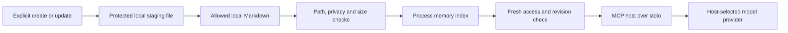

# Privacy, GDPR and KVKK

Project Vault provides technical safeguards for a project knowledge layer. Deployment purpose, lawful basis, notices, contracts, retention schedules, data-subject responses and transfer arrangements belong to the deploying organization. The project does not claim GDPR/KVKK certification or universal legal compliance.

## Data flow and lifecycle



The server has no model client, analytics, telemetry, HTTP listener, remote note storage or persistent search database. Your host may log tool responses or forward them to a provider. The host/provider arrow is controlled by the host, not by this server. Check processing locations, provider retention, training settings and contracts before connecting sensitive projects.

| Data | Location and lifetime | Control |
| --- | --- | --- |
| Notes and configuration | Existing local files until the owner changes or removes them. | Expose only necessary roots; use encryption and filesystem ACLs. |
| Parsed note text, links and ranking state | Process RAM; index generations replace previous references. | Fresh checks block revoked/stale results. Stop the process for incident containment; JavaScript garbage collection is not verified memory erasure. |
| Replacement note bytes | Hidden sibling staging file during applied writes; crash residue may persist. | Restricted staging permissions/security metadata; inspect ownership before cleanup. |
| Writer locks | Account-home `.project-vault-mcp/locks`; normally removed on completion. | PID and timestamp only; no note body or note ID. Crash locks require ownership checks before removal. |
| Audit events | JSON stderr; server creates no audit file. | Tool name, random request ID, timestamp, outcome, error code and duration only. Collection and deletion are host responsibilities. |
| Tool results | Host memory/history/logs and possibly a remote provider. | Host permissions, provider contracts and the organization's retention/transfer policy. |
| Git history, backups, sync versions and crash dumps | Outside this server. | Owner-managed lifecycle; removing a note does not erase historical copies. |

## Minimize before connecting

Prefer architectural facts, pseudonymous examples and synthetic fixtures. Keep customer records, credentials and special-category personal data outside exposed roots. The following frontmatter restricts a note from reads, search, context and tool writes:

```yaml
---
ai_access: false
personal_data: true
classification: restricted
---
```

Any one restriction is sufficient. Existing `private: true` and `visibility: private` remain supported. `classification: confidential` also denies access. An `expires_at` timestamp excludes a note after its stated time; malformed privacy metadata denies access. Expiry is access revocation, not deletion. These labels are owner-supplied policy, not automatic detection of every personal-data field. Review [configuration](configuration.md) before applying labels to existing vaults.

The default credential guard also blocks a small set of recognizable key/token signatures before note exposure or candidate writes. It is not comprehensive secret detection or personal-data classification.

## Responsibility map

The following is a technical mapping to the [GDPR text](https://eur-lex.europa.eu/legal-content/EN/TXT/?qid=1618398943851&uri=CELEX%3A32016R0679) and [KVKK security obligations](https://www.kvkk.gov.tr/Icerik/2040/Veri-Guvenligine-Iliskin-Yukumlulukler), not a legal assessment of your processing.

| Area | Project support | Organization must supply |
| --- | --- | --- |
| GDPR Articles 5 and 25; KVKK purpose/minimization principles | Scoped roots, bounded excerpts, privacy exclusions, no telemetry or durable search database. | Defined purpose, lawful basis, accurate inventory, notices and minimum necessary content. |
| GDPR Article 32; KVKK Article 12 | Access checks, secure updates, resource limits, minimized diagnostics and regression/static/dependency checks. | Risk assessment, OS security, encryption where appropriate, access reviews, backups and incident response. |
| Rectification, erasure and retention | Version-aware note updates; current-access checks and expiration restrictions. | Identity verification, deadlines, retention/hold decisions, authorized deletion and cleanup across Git, backups, host history and providers. |
| Accountability | English control map, threat model and metadata-only operational events. | Processing records, processor agreements, audit evidence and review cadence. |
| International transfers | Server makes no external note request. | Assess host/provider forwarding under GDPR Chapter V and the current KVKK Article 9 transfer framework. |

KVKK's [official transfer guidance](https://www.kvkk.gov.tr/Icerik/2053/Yurtdisina-Aktarim) describes the applicable adequacy, safeguard and exceptional-transfer framework. A local server does not remove onward-transfer obligations when a host sends results abroad. The organization's privacy owner should assess its actual recipients and circumstances.

## Requests and incidents

Use the [security operations runbook](security-operations.md) to restrict access, correct or remove notes, verify future retrieval and account for downstream copies. Avoid putting subject names, note content or credentials into public GitHub issues or audit logs. Disabling a tool does not revoke content already delivered to a client.
